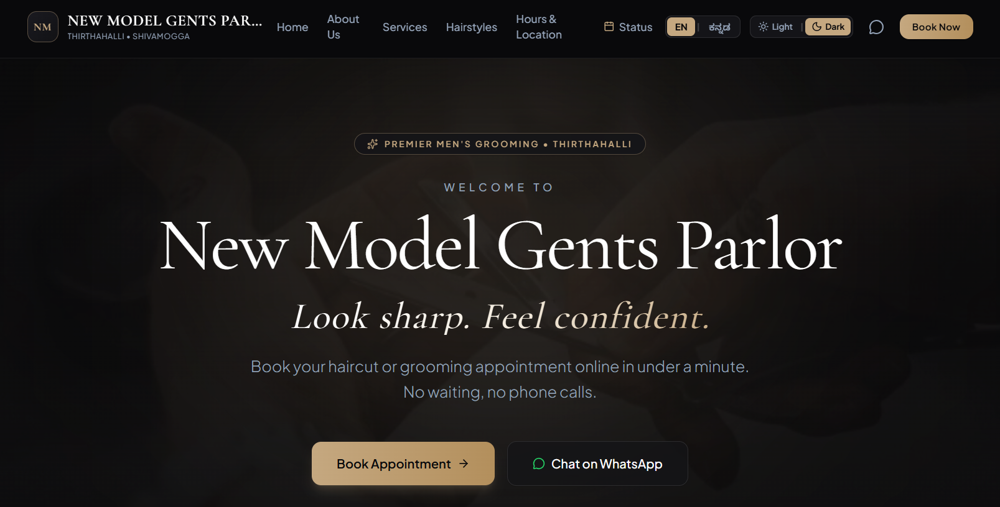
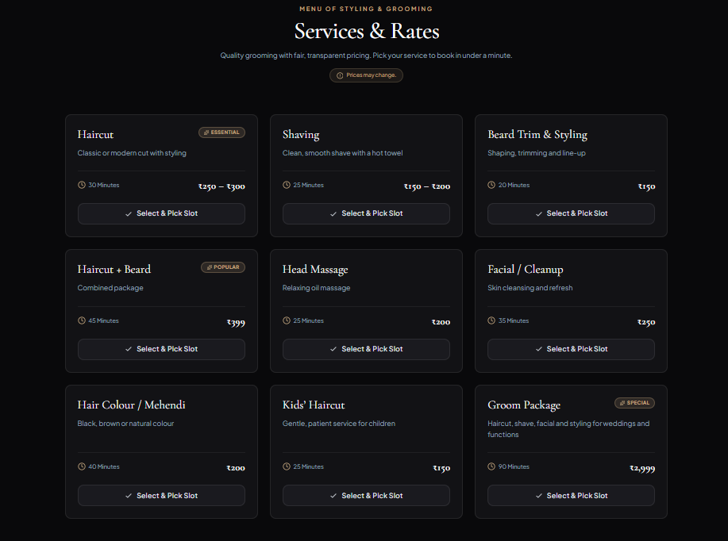
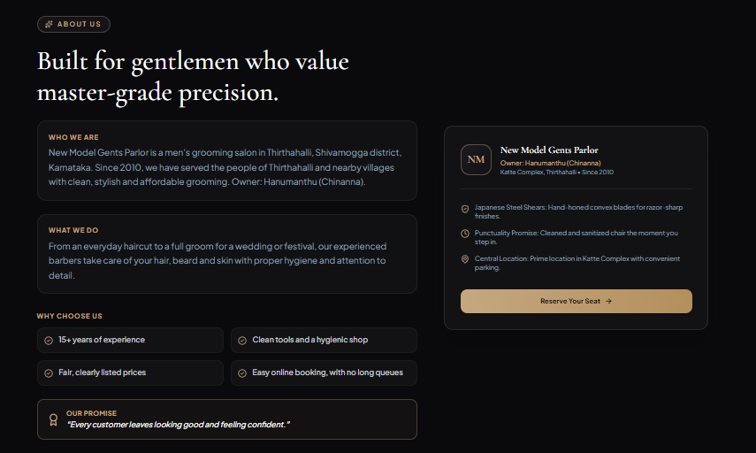
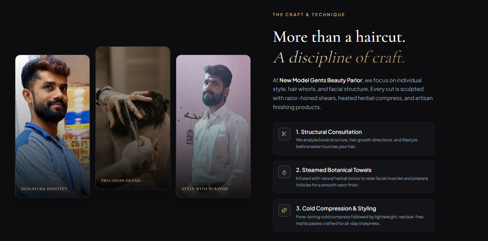
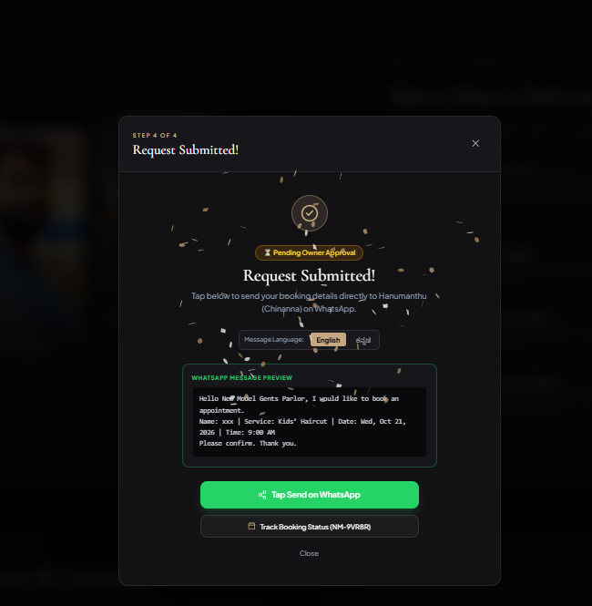
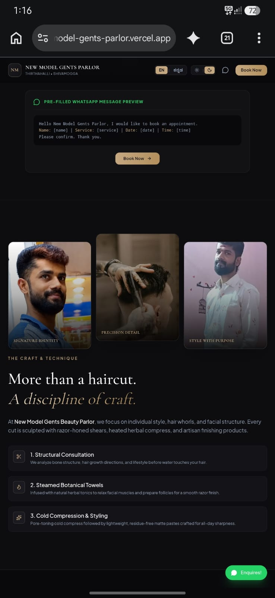
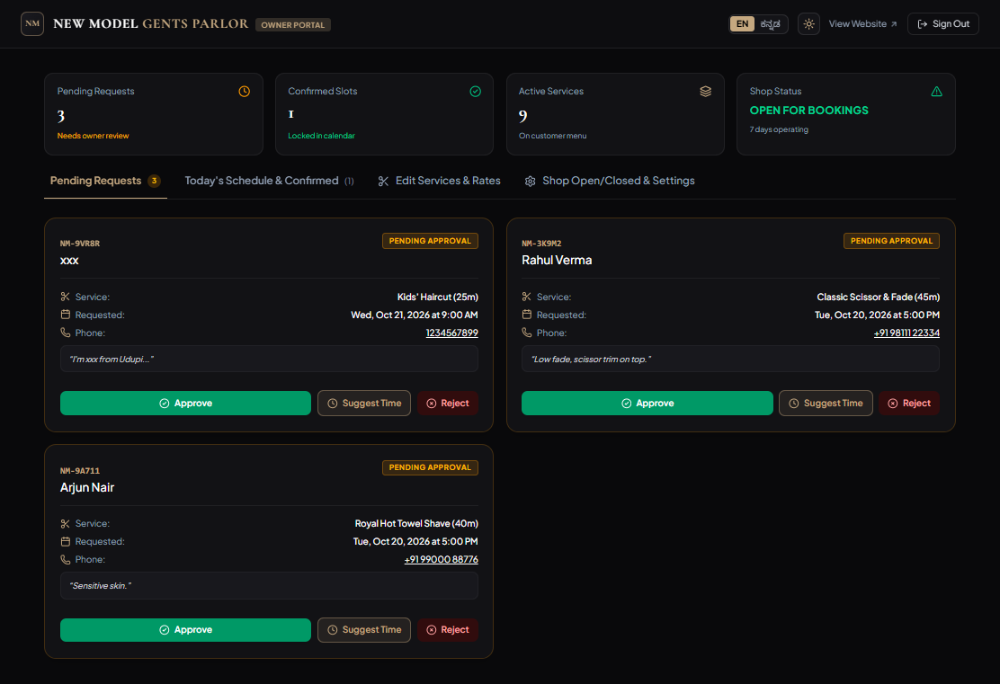
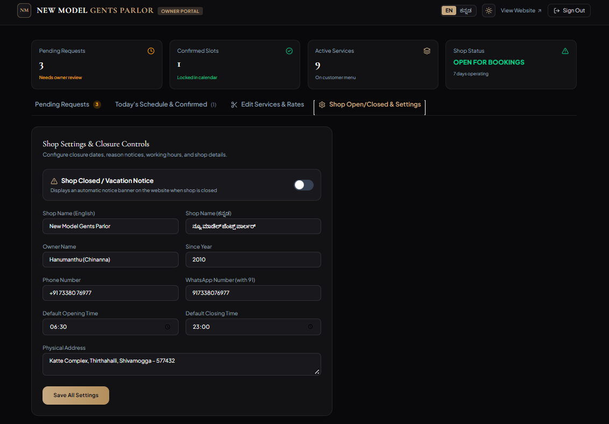

<div align="center">

# ✂️ New Model Gents Parlor

### A Modern Grooming Experience for Thirthahalli

A modern, responsive barber shop website designed to bring convenient
appointment booking and a better digital experience to local customers.

Built with Next.js · React · TypeScript · Tailwind CSS

<br />

[🌐 Live Website](https://new-model-gents-parlor.vercel.app) ·
[✨ Features](#-features) ·
[📸 Screenshots](#-website-preview) ·
[🛠️ Installation](#️-getting-started)

<br />

[](https://new-model-gents-parlor.vercel.app)
[](https://nextjs.org/)
[](https://www.typescriptlang.org/)

</div>

---

## 📖 About the Project

**New Model Gents Parlor** is a modern web project created for a local
gents parlor in Thirthahalli, Shivamogga, Karnataka, India.

The project aims to make essential grooming information accessible
online while providing customers with a convenient way to explore
services and book appointments.

Combining an elegant dark aesthetic, gold accents, responsive layouts,
and interactive components, the website offers a modern digital
experience for both customers and shop management.

The goal is simple: connect a local grooming business with its
customers through a convenient and user-friendly online experience.

---

## ✨ Features

- 🎨 **Modern UI:** Elegant typography, dark styling, and gold accents.
- 📱 **Responsive Design:** Layouts designed for desktop, tablet, and mobile.
- 📅 **Appointment Booking:** An interface for requesting grooming appointments.
- ✂️ **Services Showcase:** Explore available grooming services.
- 💈 **Hairstyle Gallery:** Browse haircut styles and grooming inspiration.
- 📍 **Shop Information:** Location, contact details, and opening hours.
- 🌐 **Language Support:** English and Kannada interface options.
- 🌓 **Theme Switching:** Dark and light appearance options.
- 🛠️ **Owner Dashboard:** Shop management interface.
- 💬 **WhatsApp Integration:** Convenient customer communication.
- 🚀 **Deployment:** Hosted on Vercel.

> Note: Features that depend on database configuration, authentication,
> or production setup must be configured and tested before being relied
> upon by customers.

---

## 📸 Website Preview

### 🏠 Homepage


### ✂️ Services


### 👔 About Us



### 📅 Appointment Booking


### 📱 Mobile View


### 🛠️  Shop Management



---

---

## 🔐 Security

Security is especially important for an application that handles customer appointments and shop management.

- Keep environment files and private credentials out of Git.
- Configure appropriate database access policies.
- Validate appointment submissions on the server.
- Protect owner-only management functionality.
- Restrict access to customer information.
- Avoid exposing private server credentials to the browser.
- Test authentication and authorization before production use.

---

## 🗺️ Future Improvements

Potential improvements include:

- Enhanced appointment management.
- Improved booking status notifications.
- Better customer and owner workflows.
- Performance and accessibility improvements.
- Custom domain integration.
- Additional automated testing.
- Further improvements to mobile usability.

---

## 🖥️ Tech Stack

| Technology | Purpose |
|---|---|
| Next.js | React framework and application routing |
| React | Component-based user interface |
| TypeScript | Type safety and maintainable code |
| Tailwind CSS | Responsive styling and layout |
| Lucide React | Interface icons |
| Motion | Animations and interactive transitions |
| Supabase | Database and backend services, if configured |
| Git & GitHub | Version control and source code hosting |
| Vercel | Deployment and hosting |

---

## 🌐 Live Demo

**Live Website:**  
https://new-model-gents-parlor.vercel.app

**GitHub Repository:**  
https://github.com/Yashugajendra/new-model-gents-parlor

---

## 👨‍💻 Developer

**Yashwanth**

- **GitHub:** [@Yashugajendra](https://github.com/Yashugajendra)
- **Project Repository:** [New Model Gents Parlor](https://github.com/Yashugajendra/new-model-gents-parlor)
- **Live Website:** [Visit Website](https://new-model-gents-parlor.vercel.app)

Built with a focus on modern web development, practical business needs, and a better digital experience for local customers.

---

<div align="center">

### Made with ❤️ for New Model Gents Parlor

**Thirthahalli · Shivamogga · Karnataka, India**

</div>

---

## ⚙️ Getting Started

Follow these instructions to run the project locally.

### Prerequisites

Install the following:

- [Node.js](https://nodejs.org/) — LTS version recommended
- npm
- Git

### 1. Clone the repository

```bash
git clone https://github.com/Yashugajendra/new-model-gents-parlor.git
